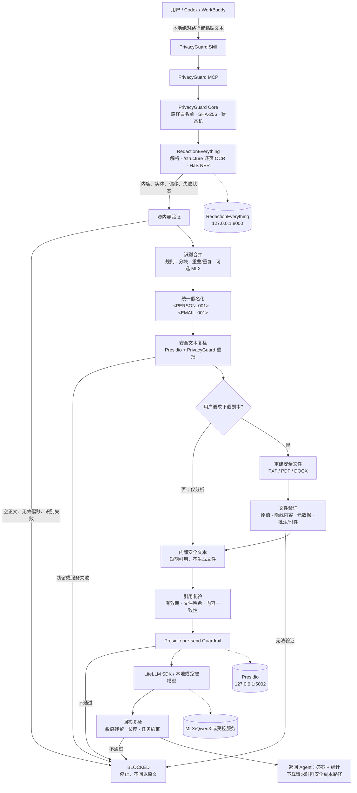
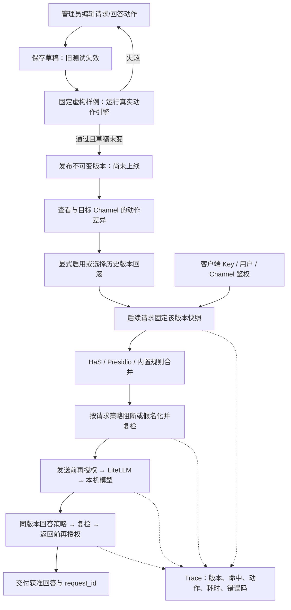
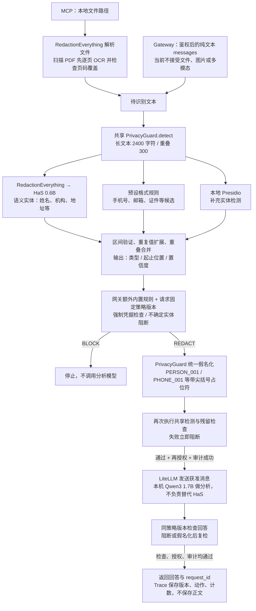
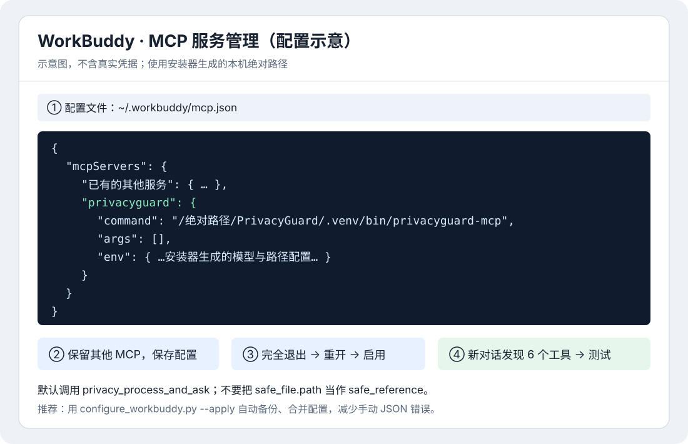

# PrivacyGuard

PrivacyGuard 是面向中文法律材料的本地敏感信息识别、人工复核和假名化工具。原始文件、识别结果和映射默认只在本机处理。

本仓库现在同时提供 Agent 安全入口：Microsoft Presidio、PrivacyGuard Core、MCP Server 和 Codex Skill。详细新手步骤见 [START_HERE.md](START_HERE.md)，产品与安全边界见 [PRD.md](PRD.md) 和 [ARCHITECTURE.md](ARCHITECTURE.md)。

文档统一入口：[文档导航](docs/README.md) · [安全脱敏原理](docs/privacy-principles.md) · [数据流与安全边界](docs/data-flow-and-boundaries.md) · [可复现验收](docs/reproducible-acceptance.md)。

以下为不同产品入口的能力汇总，不能理解为 MCP 和 Gateway 均已支持全部功能：

- TXT、Markdown、EML、DOCX 和有文本层的 PDF；
- 手机号、身份证、邮箱、银行卡等规则识别；
- Apple Silicon 上通过 Qwen3 + MLX 识别人名、机构、地址和法律角色；
- 候选高亮、逐项确认、重叠检查和导出前复核；
- Token、语义假名（人员A/机构A）和自然假名（李明/星河科技）三种替换方式；
- 有文本层 PDF 的安全删除和原位假名写入；
- AES-256-GCM 加密映射导出。

上面的人工复核、多种假名、原位 PDF 写入和映射导出属于桌面/文档处理功能；MCP 默认采用 HaS + 规则 + Presidio 识别和结构化占位符，安全副本采用独立重建验证；Gateway 当前只处理非流式纯文本，不提供文件导出或授权回填。额外 MLX NER 默认关闭；Qwen3 在默认受控链路中负责分析。入口差异及尚未解决的缺口见 [安全边界](docs/data-flow-and-boundaries.md)。

## 总体架构与执行边界

下面是当前实现的主流程。后续功能必须接入这张图规定的边界：RedactionEverything 负责文件解析和 HaS 识别，PrivacyGuard 负责统一假名化、验证和调度，Presidio 负责补充检测及发送前复检，LiteLLM 只接收已经批准的安全内容。



流程规则：普通聊天只走“内部安全文本”分支，不生成 PDF/DOCX；只有明确要求下载时才进入文件重建和结构验证。任何 `BLOCKED` 都是终点，Agent 不得读取原文件、改用通用 OCR 或把原文直接交给模型。MCP/Skill 是协作式边界，不能拦截宿主 Agent 在调用工具前自行读取文件，也不能接管 Codex/WorkBuddy 的内置模型流量。

详细接口、格式限制和验收结果见 [统一处理流程与验收](docs/unified-pipeline-verification.md)。

最新实测见 [OCR、真实材料标注与回答质量验收](docs/ocr-and-quality-acceptance.md)：两页扫描 PDF 与本地模型受控回答已跑通；5 份真实材料、60 个候选仍需人工确认，真实召回率尚未产生。

## Gateway：本机原型与管理后台规划

已实现 [策略编辑 → 测试 → 发布 → 启用 → Trace → 回滚](docs/gateway-policy-workflow.md)：后台可按类型编辑请求/回答的 `REDACT` 或 `BLOCK` 动作，保存后运行 45 个固定虚构断言，通过后生成不可变版本，再显式绑定 Channel。草稿和发布本身不改变线上行为。内置表达式仍由代码维护，不开放任意正则和敏感原值放行；回填暂不实现。

2026-11-04：本机网关及管理员后台已实现。后台 `http://127.0.0.1:8787/admin` 支持用户、Channel、授权、Key 发放/撤销、虚构材料真实调用及审计；每个 Key 绑定用户和 Channel。API 地址 `http://127.0.0.1:8787/v1`。浏览器已验收真实识别/假名化 → LiteLLM → 本机模型 → 回答检查，以及策略启用阻断、回滚恢复和 Trace 版本核对，见 [后台使用](docs/gateway-admin.md)、[原型启动指南](docs/gateway-local-run.md) 和 [策略与 Trace](docs/gateway-policy-trace.md)。仍仅支持单组织本机部署、固定上游和非流式纯文本；回填、多模型管理及 WorkBuddy/Codex 原生客户端兼容后置。



任一必要检查失败就阻断，不发送未经批准的请求或交付未经批准的回答。Trace 不保存正文、原值、密钥或映射。策略切换仅影响新请求；Key 撤销和通道禁用仍在发送前、返回前重新检查。

### 管道如何识别，而不只是匹配正则

网关与 MCP **复用 `PrivacyGuard.detect` 识别核心**：默认由 RedactionEverything 调用 **HaS 0.6B 小模型**扫描文本，合并预设格式规则和 Presidio 补充检测。策略不是识别模型：模型回答“哪一段是什么实体”，策略版本决定“这种实体应脱敏还是阻断”。修改动作不会训练模型，也不会关闭其他实体检测。



图中共享检测后的策略/授权/Trace 部分是网关执行路径；MCP 使用自己的安全引用和受控问答调度，**不是自动串行穿过网关**。MCP 文件输出另有安全副本验证，网关文本请求不会运行 OCR 或生成文件。额外 MLX NER 仅在显式配置后启用，默认不是必需的第二个识别模型。

安全保证是“所有必选检查通过后才能发送或返回，检查失败不退回原文”，不是“模型绝对不会漏识别”。Trace 证明该请求经过了哪些检查，不能证明零漏敏。识别服务会在本机接触原文；不留存 Trace 正文不等于解析服务不落盘，文件上传区和本机临时文件仍需单独管理。完整职责、代码依据、测试证据及限制见 [识别管道技术路线](docs/gateway-recognition-architecture.md)。

计划在现有文件处理 / MCP 层之后增加 API 安全网关：管理员统一管理用户、网关 Key、上游模型、Channel、请求/回答策略、测试、版本发布和审计。Channel 绑定授权用户、一个上游连接及确切策略版本；保存草稿不立即上线，测试后显式启用。

管理员流程：创建用户 → 配置上游 → 编写并测试策略 → 绑定 Channel → 启用版本 → 发放接入信息 → 验收调用 → 审计、撤销与回滚。

实施顺序：最小非流式文本管道 → 管理后台 → 实际客户端验收 → 独立 Vault 与授权回填。首版不支持的流式、工具调用、多模态等明确拒绝。MCP 配置不等于网关接入；只有实际经过网关的 API 流量受管控。

- [完整目标架构、后台流程与管控规则](docs/gateway-design.md)
- [分阶段 TODO 与验收矩阵](docs/gateway-todo.md)
- [GitHub 跟踪 Issue #1](https://github.com/bseazh/PrivacyGuard/issues/1) · [仓库内任务正文](docs/gateway-epic.md)

以下文档描述完整目标，不能将原型验收等同于全部目标完成；现有安装入口和 MCP 链路保持原有流程。

## 现有文件处理链路的后续工作

按这张架构图，下一阶段先做输入完整性，再做识别质量，最后做用户体验：

1. **真实材料标注验收（P0）**：当前已在仓库外的 5 份材料上生成 60 个本地候选，待人工逐项确认后计算 precision、recall、误报率和人工修正次数；原文及 gold 不上传。
2. **OCR 坐标与版式（P1）**：扫描 PDF 的逐页全文 OCR、页码覆盖和 HaS 识别已接通；下一步是坐标级原版式回写。当前下载副本仍是纯文本重建，不保留扫描图片或原排版。
3. **人工 REVIEW 状态（P1）**：对低置信度姓名、机构、地址、法院、律所和项目提供确认/忽略界面，记录类别和统计，不记录原始值；确认后重新生成安全文本和副本。
4. **分析答案质量（P1）**：用人工标注的合同风险基准约束 LiteLLM 输出，单独验收事实依据、缺失不推定、引用逐字一致；隐私链路通过不等于法律分析正确。
5. **格式扩展（P2）**：OCR 验收后再评估图片、XLSX、VCF、ICS、音频和 ZIP，所有新格式复用同一验证、假名化和 `BLOCKED` 边界。

## 一句话安装

不提供 DMG 或捆绑应用。macOS Apple Silicon 用户在终端粘贴一条命令：

```bash
curl -fsSL https://privacyguard.snorlaxden.fun/install.sh | bash
```

脚本默认安装到 `~/Documents/PrivacyGuard`，预检 Apple Silicon、内存、磁盘、编译工具和 Python 3.11。固定提交源码与模型优先从国内服务器下载，源码另有 GitHub 备用；全部强制校验 SHA-256。随后安装并启动 HaS/PaddleOCR、规则、Presidio、MLX/Qwen3、LiteLLM，运行 MCP、扫描 PDF OCR 和真实模型验收。网络不通、预检或验收失败会停止，不能跳过校验。

**WorkBuddy 用户**：安装后先退出 WorkBuddy，再运行以下命令安全合并 MCP（保留现有服务、备份配置、同名冲突不覆盖）：

```bash
~/Documents/PrivacyGuard/.venv/bin/python ~/Documents/PrivacyGuard/scripts/configure_workbuddy.py --apply
```

想在截图所示的 MCP 编辑窗口手动粘贴，运行：

```bash
~/Documents/PrivacyGuard/.venv/bin/python ~/Documents/PrivacyGuard/scripts/configure_workbuddy.py --copy-entry
```

脚本会自动使用当前用户名、安装目录和模型路径，把完整的 `"privacyguard": {...}` 条目复制到剪贴板，同时保存到 `~/Documents/PrivacyGuard/local-config/workbuddy-privacyguard-entry.json`。在现有 `mcpServers` 的 `{}` 内粘贴，并与相邻服务用逗号隔开；不要照图片抄占位路径。完整包装配置另存为 `local-config/workbuddy-mcp.json`。

给安装 Agent 的一句话任务：

```text
请按照 https://github.com/bseazh/PrivacyGuard/blob/main/AGENT_INSTALL.md 在这台 Mac 安装 PrivacyGuard；先预检系统、内存、磁盘和网络，使用国内入口下载并校验，完成 OCR、MCP 和 LiteLLM 验收。询问我使用 Codex 还是 WorkBuddy；如果是 WorkBuddy，先让我完全退出应用，再备份并合并 MCP，重开后用虚构材料验证六个工具。任何 blocked 或校验失败都停止，不读取真实文件绕过。
```

重开应用，按 [WorkBuddy 配置、配图与聊天验收](docs/workbuddy.md) 操作。Codex 已安装 CLI 时，安装器尝试注册 MCP/Skill；同名配置不会覆盖。WorkBuddy Skill 按版本手动导入 `skills/privacyguard/`，也可使用指南中的项目规则。



国内服务器 `https://privacyguard.snorlaxden.fun` 提供脚本、固定源码和独立权重，不用 GitHub Release 承载模型。备用安装命令为 `curl -fsSL https://raw.githubusercontent.com/bseazh/PrivacyGuard/main/install.sh | bash`。完整能力目前仅验收 Apple Silicon，Windows/Intel Mac 不承诺一句话可用。

组件总下载量约 4GB，安装后建议保留至少 12GB 可用空间。当前一句话完整模式只支持 M1/M2/M3/M4 系列 Mac；Windows 与 Intel Mac 尚未验收，不会伪装成可用。

以后启动：

```bash
~/Documents/PrivacyGuard/scripts/start_privacyguard.sh
```

### Agent 隐私处理

MCP 提供六个工具。Agent 默认只调用高层入口 `privacy_process_and_ask`：它在内部完成文件扫描、脱敏、安全引用隔离、LiteLLM 发送前 Presidio Guardrail 和回答复检，不把安全正文或完整引用暴露给 Codex/WorkBuddy。其余 `privacy_scan_file`、`privacy_get_safe_content`、`privacy_scrub_text`、`privacy_redact_file`、`privacy_secure_ask` 用于受控的分步流程和调试。

本仓库是统一编排和版本管理入口：`privacyguard/` 管理 Presidio、RedactionEverything、LiteLLM 与安全引用适配，`service/` 管理本地识别与文档处理，`scripts/` 管理安装、启停和端到端验收。安装后 RedactionEverything 源码位于仓库内的 `redaction-everything/`，Python 依赖位于隔离虚拟环境；Qwen3、HaS、PaddleOCR 等大模型权重只从国内服务器下载到本地安装目录，不提交 GitHub。

所有文件先交给 RedactionEverything 解析与 HaS 识别，PrivacyGuard 合并规则和 Presidio 补充结果，统一生成 `<PERSON_001>` 等占位符并复检。长文本按 2400 字符、300 字符重叠分块，重叠实体取覆盖区间，同名重复实体保持相同占位符。默认仅分析内部安全文本，不生成 PDF/DOCX；用户要求下载时才重建并验证独立副本。完整流程与验收见 [统一处理流程](docs/unified-pipeline-verification.md)。

Apple Silicon 可显式额外启用 MLX 实体识别。普通“合同/协议/测试/项目”等词不会单独作为项目名，低置信度的项目、机构、地址、法院或律所实体在生成安全副本时会阻断并要求人工确认：

```bash
export PRIVACYGUARD_MLX_PYTHON="$PWD/.venv-mlx/bin/python"
export PRIVACYGUARD_ENABLE_MLX_ENSEMBLE=1
.venv/bin/privacyguard redact /绝对路径/合同.docx
```

这两个变量必须传给实际启动 MCP 的进程；只在另一个终端设置不会改变已运行的 Codex。单独设置 Python 路径不会启用 MLX 实体识别；显式启用后 MLX 失败会阻断，不会静默降级。MLX/Qwen3 作为 LiteLLM 的分析模型与此开关相互独立。

`privacy_redact_file` 为 PDF/DOCX 生成经过复检的独立安全副本，TXT/Markdown/纯文本 EML 导出为独立 UTF-8 `.txt` 文件，再通过安全引用读取路径。PDF/DOCX 当前采用纯文本重建，不保留原排版；原附件、属性、批注等不会复制。扫描 PDF 必须完成逐页 OCR 校验；未验证图片、修订或动态复杂对象仍阻断，分析入口也不放行不完整 PDF/DOCX。MIME 多部件、附件、编码邮件暂不支持。此入口不同于下文的桌面端原位 PDF 导出。历史验证范围见 [文件级安全输出说明](docs/file-output-verification.md)。

### 受控 LiteLLM 调用

`privacy_secure_ask` 只接受 `privacy_scan_file`/`privacy_redact_file`/`privacy_scrub_text` 返回的安全引用与固定任务 `risk_summary` 或 `summary`。会再次验证引用、文件哈希、抽取内容，并用本地 Presidio 在 LiteLLM 请求前检查；任何错误阻断。不会接收用户任意原始 prompt、路径、模型地址或模型参数。仅在 PrivacyGuard 自己管理的请求内生效，不会接管 Codex 自带模型流量。

首次安装已加 LiteLLM SDK。当前本机模型链路由既有 MLX Qwen3 OpenAI-compatible server 提供，在 MCP 启动环境配置 `PRIVACYGUARD_LLM_MODEL=openai//绝对路径/到/Qwen3-1.7B-bf16`、`PRIVACYGUARD_LLM_BASE_URL=http://127.0.0.1:8011/v1`、`PRIVACYGUARD_LLM_API_KEY=local-only`。外部模型必须设置 HTTPS 和独立密钥；发送脱敏后的内容仍意味着该内容离开本机。

CLI：`privacyguard ask <safe_reference> --task risk_summary`。MCP 工具是 `privacy_secure_ask`。本地测试上游顺序和真实 MLX 端到端结果见 [LiteLLM 受控调用验收](docs/litellm-secure-ask.md)。

Codex 配置模板在 [config/codex-mcp.toml](config/codex-mcp.toml)，Skill 源文件在 [skills/privacyguard/SKILL.md](skills/privacyguard/SKILL.md)。用户级配置需要按机器绝对路径填写，修改后重启 Codex。

取得用户同意后可单独运行 `./scripts/install_codex_integration.sh`；一键安装器使用非交互 `--yes` 模式，但仍拒绝覆盖已有同名 MCP 或 Skill。

详细步骤见 [INSTALL.md](INSTALL.md)，常见问题见 [FAQ.md](FAQ.md)。让编码 Agent 自动安装时，把 [AGENT_INSTALL.md](AGENT_INSTALL.md) 交给 Agent。

## PDF 假名化如何工作

确认候选并选择替换方式后，PDF 导出会：

1. 在 PDF 文本层中精确定位原敏感文字；
2. 使用 redaction annotation 删除底层原文字，而不是只盖白框；
3. 在原位置写入稳定假名，同一实体全文保持一致；
4. 重新打开输出文件，检查原敏感文字是否仍可搜索；
5. 任一实体无法定位或安全检查失败时拒绝导出。

扫描 PDF 已通过 `/structure` 逐页 OCR；每页必须返回非空文本，页数和逐页结果必须一致，OCR 文本还会重新经过 HaS 与完整复检。该覆盖检查只能证明每页参与了 OCR，不能证明字符级零漏识别。扫描件可用于受控分析及纯文本重建副本，但尚未接入原版式坐标回写。

## 本地开发和测试

```bash
source .venv-mlx/bin/activate
python -m unittest discover -s tests
npm --prefix app test
npm --prefix app run build
```

本地服务监听 `127.0.0.1:8766`，健康检查地址为 `http://127.0.0.1:8766/health`。

## 模型权重

macOS 语义识别使用 `mlx-community/Qwen3-1.7B-bf16`，完整目录约 3.2GB，不提交到 Git：

```bash
source .venv-mlx/bin/activate
python scripts/download_model.py
```

一键安装器从国内服务器下载独立 Qwen3、HaS 和 PaddleOCR 组件，不下载 DMG。开发者仍可使用 `scripts/download_model.py` 管理本地模型缓存。

## 安全与许可证提示

- 假名化 PDF 不能从输出文件本身复原；授权恢复需要原始文件和单独保存的加密映射。
- 浏览器本地存储中的映射密钥尚未实现跨设备备份，清理应用数据前请谨慎处理。
- PyMuPDF 为 AGPL/商业双许可证。闭源商业分发前需要购买 Artifex 商业许可，或替换为许可证兼容的 PDF 引擎。
- 上游 `RedactionEverything` 通过用户已有且已授权的本地 HTTP 服务接入；本仓库不复制其受限制代码、模型或视觉链路。机构、商业或付费使用仍需遵守其单独许可。
- 模型和依赖的再分发许可应在每次发布前重新核对。
- Presidio 为 MIT License；本项目参考本地源码但适配代码写在自身 `privacyguard/adapters/` 中。
- LiteLLM 只保护 `privacy_secure_ask` 中由 PrivacyGuard 自己发起的请求，不接管 Codex/WorkBuddy 内置模型请求。
- Skill/MCP 是协作式安全流程，无法强制阻止宿主 Agent 在调用工具前自行读取原文件。
