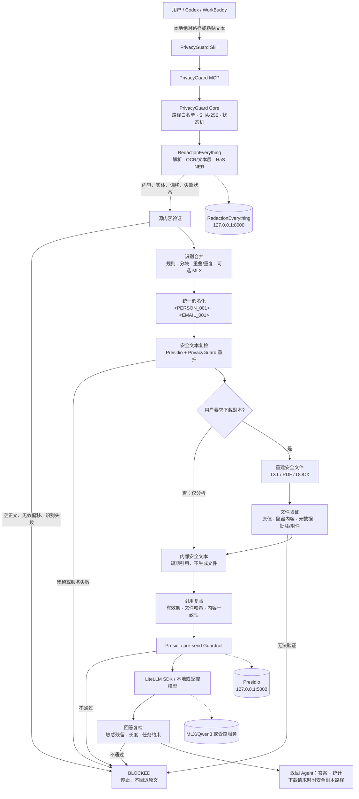

# PrivacyGuard

PrivacyGuard 是面向中文法律材料的本地敏感信息识别、人工复核和假名化工具。原始文件、识别结果和映射默认只在本机处理。

本仓库现在同时提供 Agent 安全入口：Microsoft Presidio、PrivacyGuard Core、MCP Server 和 Codex Skill。详细新手步骤见 [START_HERE.md](START_HERE.md)，产品与安全边界见 [PRD.md](PRD.md) 和 [ARCHITECTURE.md](ARCHITECTURE.md)。

当前支持：

- TXT、Markdown、EML、DOCX 和有文本层的 PDF；
- 手机号、身份证、邮箱、银行卡等规则识别；
- Apple Silicon 上通过 Qwen3 + MLX 识别人名、机构、地址和法律角色；
- 候选高亮、逐项确认、重叠检查和导出前复核；
- Token、语义假名（人员A/机构A）和自然假名（李明/星河科技）三种替换方式；
- 有文本层 PDF 的安全删除和原位假名写入；
- AES-256-GCM 加密映射导出。

## 总体架构与执行边界

下面是当前实现的主流程。后续功能必须接入这张图规定的边界：RedactionEverything 负责文件解析和 HaS 识别，PrivacyGuard 负责统一假名化、验证和调度，Presidio 负责补充检测及发送前复检，LiteLLM 只接收已经批准的安全内容。



流程规则：普通聊天只走“内部安全文本”分支，不生成 PDF/DOCX；只有明确要求下载时才进入文件重建和结构验证。任何 `BLOCKED` 都是终点，Agent 不得读取原文件、改用通用 OCR 或把原文直接交给模型。MCP/Skill 是协作式边界，不能拦截宿主 Agent 在调用工具前自行读取文件，也不能接管 Codex/WorkBuddy 的内置模型流量。

详细接口、格式限制和验收结果见 [统一处理流程与验收](docs/unified-pipeline-verification.md)。

## 下一阶段工作顺序

按这张架构图，下一阶段先做输入完整性，再做识别质量，最后做用户体验：

1. **OCR 完整闭环（P0）**：让 RedactionEverything 对扫描 PDF 返回完整逐页 OCR 文本、页码覆盖、失败状态和可验证偏移；PrivacyGuard 验证覆盖完整后才允许分析或导出。当前短页/扫描页必须阻断。
2. **真实材料标注验收（P0）**：使用脱离仓库的本地样本建立至少 100 个实体的标注集，比较规则、HaS、规则+HaS 的召回率、误报率、人工修正次数、延迟和内存；不上传原文。
3. **人工 REVIEW 状态（P1）**：对低置信度姓名、机构、地址、法院、律所和项目提供确认/忽略界面，记录类别和统计，不记录原始值；确认后重新生成安全文本和副本。
4. **分析答案质量（P1）**：用人工标注的合同风险基准约束 LiteLLM 输出，单独验收事实依据、缺失不推定、引用逐字一致；隐私链路通过不等于法律分析正确。
5. **格式扩展（P2）**：OCR 验收后再评估图片、XLSX、VCF、ICS、音频和 ZIP，所有新格式复用同一验证、假名化和 `BLOCKED` 边界。

## 一句话安装

不提供 DMG 或捆绑应用。macOS Apple Silicon 用户在终端粘贴一条命令：

```bash
curl -fsSL https://privacyguard.snorlaxden.fun/install.sh | bash
```

脚本默认安装到 `~/Documents/PrivacyGuard`，会预检 Apple Silicon、内存、磁盘和 Python 3.11，从国内服务器断点下载源码与独立模型组件，强制校验 SHA-256，然后安装并启动规则引擎、Presidio、RedactionEverything 的 HaS/PaddleOCR、MLX/Qwen3、LiteLLM，以及 Codex MCP/Skill。安装器最后会真正运行 MCP 与 `privacy_secure_ask` 端到端测试。

组件总下载量约 4GB，安装后建议保留至少 12GB 可用空间。当前一句话完整模式只支持 M1/M2/M3/M4 系列 Mac；Windows 与 Intel Mac 尚未验收，不会伪装成可用。

以后启动：

```bash
~/Documents/PrivacyGuard/scripts/start_privacyguard.sh
```

### Agent 隐私处理

MCP 提供六个工具。Agent 默认只调用高层入口 `privacy_process_and_ask`：它在内部完成文件扫描、脱敏、安全引用隔离、LiteLLM 发送前 Presidio Guardrail 和回答复检，不把安全正文或完整引用暴露给 Codex/WorkBuddy。其余 `privacy_scan_file`、`privacy_get_safe_content`、`privacy_scrub_text`、`privacy_redact_file`、`privacy_secure_ask` 用于受控的分步流程和调试。

本仓库是统一编排和版本管理入口：`privacyguard/` 管理 Presidio、RedactionEverything、LiteLLM 与安全引用适配，`service/` 管理本地识别与文档处理，`scripts/` 管理安装、启停和端到端验收。安装后 RedactionEverything 源码位于仓库内的 `redaction-everything/`，Python 依赖位于隔离虚拟环境；Qwen3、HaS、PaddleOCR 等大模型权重只从国内服务器下载到本地安装目录，不提交 GitHub。

所有文件先交给 RedactionEverything 解析与 HaS 识别，PrivacyGuard 合并规则和 Presidio 补充结果，统一生成 `<PERSON_001>` 等占位符并复检。长文本按 2400 字符、300 字符重叠分块，重叠实体取覆盖区间，同名重复实体保持相同占位符。默认仅分析内部安全文本，不生成 PDF/DOCX；用户要求下载时才重建并验证独立副本。完整流程与验收见 [统一处理流程](docs/unified-pipeline-verification.md)。

Apple Silicon 可显式额外启用 MLX 实体识别。普通“合同/协议/测试/项目”等词不会单独作为项目名，低置信度的项目、机构、地址、法院或律所实体在生成安全副本时会阻断并要求人工确认：

```bash
export PRIVACYGUARD_MLX_PYTHON="$PWD/.venv-mlx/bin/python"
export PRIVACYGUARD_ENABLE_MLX_ENSEMBLE=1
.venv/bin/privacyguard redact /绝对路径/合同.docx
```

这两个变量必须传给实际启动 MCP 的进程；只在另一个终端设置不会改变已运行的 Codex。单独设置 Python 路径不会启用 MLX 实体识别；显式启用后 MLX 失败会阻断，不会静默降级。MLX/Qwen3 作为 LiteLLM 的分析模型与此开关相互独立。

`privacy_redact_file` 为 PDF/DOCX 生成经过复检的独立安全副本，TXT/Markdown/纯文本 EML 导出为独立 UTF-8 `.txt` 文件，再通过安全引用读取路径。PDF/DOCX 当前采用纯文本重建，不保留原排版；原附件、属性、批注等不会复制。源文件含未验证图片、扫描页、矢量绘图、修订或复杂对象时阻断；分析入口也不放行不完整 PDF/DOCX。MIME 多部件、附件、编码邮件暂不支持。此入口不同于下文的桌面端原位 PDF 导出。历史验证范围见 [文件级安全输出说明](docs/file-output-verification.md)。

### 受控 LiteLLM 调用

`privacy_secure_ask` 只接受 `privacy_scan_file`/`privacy_redact_file`/`privacy_scrub_text` 返回的安全引用与固定任务 `risk_summary` 或 `summary`。会再次验证引用、文件哈希、抽取内容，并用本地 Presidio 在 LiteLLM 请求前检查；任何错误阻断。不会接收用户任意原始 prompt、路径、模型地址或模型参数。仅在 PrivacyGuard 自己管理的请求内生效，不会接管 Codex 自带模型流量。

首次安装已加 LiteLLM SDK。当前本机模型链路由既有 MLX Qwen3 OpenAI-compatible server 提供，在 MCP 启动环境配置 `PRIVACYGUARD_LLM_MODEL=openai//绝对路径/到/Qwen3-1.7B-bf16`、`PRIVACYGUARD_LLM_BASE_URL=http://127.0.0.1:8011/v1`、`PRIVACYGUARD_LLM_API_KEY=local-only`。外部模型必须设置 HTTPS 和独立密钥；发送脱敏后的内容仍意味着该内容离开本机。

CLI：`privacyguard ask <safe_reference> --task risk_summary`。MCP 工具是 `privacy_secure_ask`。本地测试上游顺序和真实 MLX 端到端结果见 [LiteLLM 受控调用验收](docs/litellm-secure-ask.md)。

Codex 配置模板在 [config/codex-mcp.toml](config/codex-mcp.toml)，Skill 源文件在 [skills/privacyguard/SKILL.md](skills/privacyguard/SKILL.md)。用户级配置需要按机器绝对路径填写，修改后重启 Codex。

取得用户同意后可单独运行 `./scripts/install_codex_integration.sh`；一键安装器使用非交互 `--yes` 模式，但仍拒绝覆盖已有同名 MCP 或 Skill。

详细步骤见 [INSTALL.md](INSTALL.md)，常见问题见 [FAQ.md](FAQ.md)。让编码 Agent 自动安装时，把 [AGENT_INSTALL.md](AGENT_INSTALL.md) 交给 Agent。

## PDF 假名化如何工作

确认候选并选择替换方式后，PDF 导出会：

1. 在 PDF 文本层中精确定位原敏感文字；
2. 使用 redaction annotation 删除底层原文字，而不是只盖白框；
3. 在原位置写入稳定假名，同一实体全文保持一致；
4. 重新打开输出文件，检查原敏感文字是否仍可搜索；
5. 任一实体无法定位或安全检查失败时拒绝导出。

扫描 PDF 当前尚未接入 OCR 坐标回写。系统会拒绝将无法定位的扫描件报告为安全脱敏成功。

## 本地开发和测试

```bash
source .venv-mlx/bin/activate
python -m unittest discover -s tests
npm --prefix app test
npm --prefix app run build
```

本地服务监听 `127.0.0.1:8766`，健康检查地址为 `http://127.0.0.1:8766/health`。

## 模型权重

macOS 语义识别使用 `mlx-community/Qwen3-1.7B-bf16`，完整目录约 3.2GB，不提交到 Git：

```bash
source .venv-mlx/bin/activate
python scripts/download_model.py
```

一键安装器从国内服务器下载独立 Qwen3、HaS 和 PaddleOCR 组件，不下载 DMG。开发者仍可使用 `scripts/download_model.py` 管理本地模型缓存。

## 安全与许可证提示

- 假名化 PDF 不能从输出文件本身复原；授权恢复需要原始文件和单独保存的加密映射。
- 浏览器本地存储中的映射密钥尚未实现跨设备备份，清理应用数据前请谨慎处理。
- PyMuPDF 为 AGPL/商业双许可证。闭源商业分发前需要购买 Artifex 商业许可，或替换为许可证兼容的 PDF 引擎。
- 上游 `RedactionEverything` 通过用户已有且已授权的本地 HTTP 服务接入；本仓库不复制其受限制代码、模型或视觉链路。机构、商业或付费使用仍需遵守其单独许可。
- 模型和依赖的再分发许可应在每次发布前重新核对。
- Presidio 为 MIT License；本项目参考本地源码但适配代码写在自身 `privacyguard/adapters/` 中。
- LiteLLM 只保护 `privacy_secure_ask` 中由 PrivacyGuard 自己发起的请求，不接管 Codex/WorkBuddy 内置模型请求。
- Skill/MCP 是协作式安全流程，无法强制阻止宿主 Agent 在调用工具前自行读取原文件。
