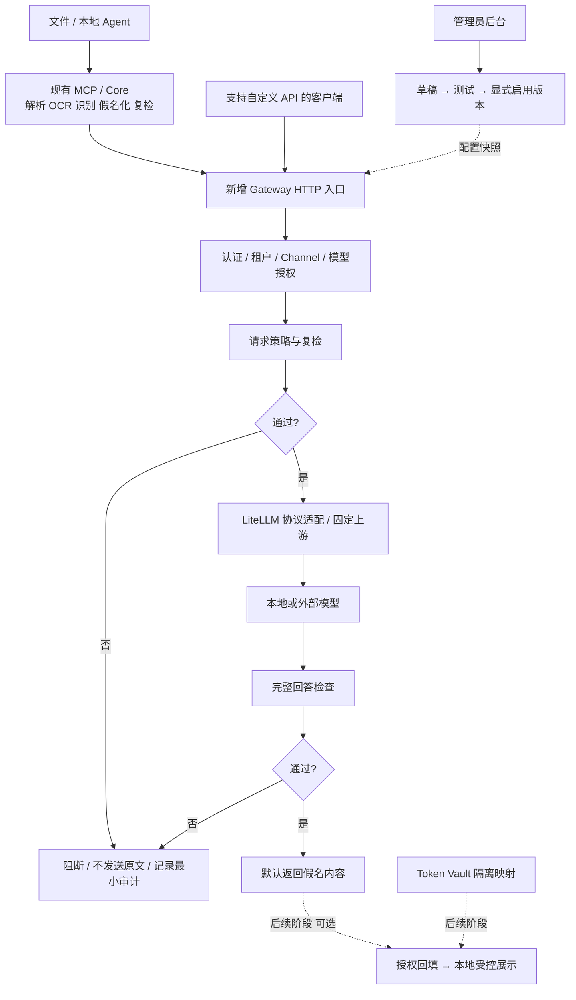

# Gateway 管理后台与管控流程（设计草案）

日期：2026-11-04。状态：待评审，尚未实现或验收。本文是后续实现基线，不代表现有 MCP 已具备网关能力。

实施进度补充：用户已同意先运行最小管道，现完成 G1 的本机单 Channel 子集，见 [运行与验收](gateway-local-run.md)。下文仍为完整目标，不代表后台、组织隔离和回填已完成。

本方案依据会议中 Channel、Security Profile、版本启用、策略测试和 Round Trip 的讨论，结合 PrivacyGuard 现有代码制定；属于我们的实现建议，不代表已取得对方产品代码或实现。会议逐字稿、客户材料、参会者信息和凭据不纳入仓库。

## 1. 目标与边界

面向管理员建立可配置、可测试、可发布、可审计的模型访问管道。律师只需配置网关 Base URL、个人网关 Key 和允许模型，不接触上游服务商密钥。

- 第一层：现有文件工作台 / MCP 负责解析、OCR、识别、假名化、复核与安全副本。
- 第二层：新增 HTTP 网关负责经过它的 API 请求的身份、授权、模型路由、输入输出策略和审计。客户端声明“已脱敏”不能免检。
- MCP 注册不等于配置模型网关；内置订阅和绕过网关的流量不在保护范围。企业强制出口控制是另一个部署议题。
- 自动检测无法保证零漏检；检测故障必须阻断，但“未检测到”不等于绝对安全。
- 现有 `secure_ask` 仅接受安全引用和固定任务，不扩展为任意代理；新增网关独立入口，复用检测能力，保持原边界。

## 2. 总体架构（目标状态）

控制面（后台、配置、发布）与数据面（请求转发）分离。后台不可用时，已有有效快照可以继续处理；无法认证、无法读取有效策略或检测异常时阻断，不使用空策略。

## 3. 管理员完整操作流程

1. **初始化**：创建首个管理员，检查数据库、检测服务、模型连接和审计存储。无默认密码；初始 Channel 禁用。原型默认仅监听本机，团队部署必须配置 TLS、鉴权和组织隔离。
2. **建立用户**：创建组织内用户，分配管理员、操作员或审计员角色；普通用户只有获授的调用权限。第一版不做 OA 同步和复杂层级组。
3. **配置上游**：填写供应商、协议、Base URL、服务商 Key、允许模型；测试连接。浏览器不能读回密钥，数据库仅存密钥引用或加密值，加密主密钥独立保管。
4. **配置策略组**：选择法律材料预设，按请求/回答设置检测项和动作。用户个性化选择只能在管理员允许范围内调整，不能关闭组织必选策略。
5. **测试草稿**：用虚构样例验证允许、脱敏、阻断及服务异常；保存预期动作和期望结果。测试页默认不发送到真实模型，真实上游测试另行明确提示。
6. **创建 Channel**：绑定一个上游、模型子集、策略组的确切版本及授权用户。第一版每个网关 Key 绑定一个用户和一个 Channel，消除隐式路由歧义。
7. **启用版本**：展示差异、测试结果及影响范围，管理员显式启用。保存不会自动上线；启用失败保留旧版本。
8. **发放接入信息**：个人 Key 只显示一次，导出不含服务商 Key 的客户端说明；按客户端版本验证所需 API 协议。MCP 指南与模型 API 配置指南分别展示。
9. **验收真实调用**：测试上游证明原值未外发、阻断时无请求、回答检查有效；再用虚构数据接真实模型。通过后才声明相应客户端兼容。
10. **持续运营**：查统计和错误、撤销 Key、禁用 Channel、发布新版本或回滚。请求保留审计 ID；不将模型调用错误误报为安全通过。

## 4. 后台页面与角色

| 页面 | 操作与反馈 |
|---|---|
| 概览 | 服务健康、启用 Channel、允许/脱敏/阻断数量及延迟；不显示原文 |
| 用户与 Key | 创建用户、授权、Key 单次展示/到期/撤销；只持久化不可逆 Key 校验值 |
| 上游连接 | 地址、协议、模型白名单、密钥引用、连接测试；无任意客户端 URL 转发 |
| Channel | 上游、允许模型、用户、策略版本、启用/禁用、配置差异 |
| 策略与版本 | 草稿编辑、优先级、必选规则、版本历史、发布、回滚 |
| 策略测试 | 虚构样例、预期动作、命中规则 ID、脱敏结果、回归测试；禁止保存真实材料 |
| 审计 | 时间、组织/用户/Channel ID、版本、动作、类型计数、耗时、错误码；默认不含正文 |

管理员管理权限和发布；操作员编辑草稿及运行测试但不能启用或读取密钥；审计员只查看获授权的最小审计信息。管理登录与模型调用 Key 分离，角色检查必须在服务端执行。

## 5. 管控对象与状态

| 对象 | 必要字段或约束 |
|---|---|
| Organization / User | tenant_id、user_id、状态、角色；全部资源按组织授权 |
| GatewayKey | key_id、校验值、用户、Channel、到期、撤销状态；不记录 Authorization |
| Upstream | 协议、固定 Base URL、密钥引用、模型白名单、配置版本 |
| Policy / ProfileVersion | 检测项、作用阶段、动作、优先级、强制项、不可变版本及测试摘要 |
| ChannelRevision | 上游版本、模型子集、策略版本、授权绑定、激活时间；固定完整依赖快照 |
| PolicyTest | 虚构输入、预期动作/替换、草稿内容哈希；修改配置后原测试状态失效 |
| AuditEvent | 请求 ID、主体、Channel、版本、动作、计数、耗时、脱敏错误码 |
| Vault（后续） | 组织/项目/会话作用域、占位符映射、接收者权限、到期时间 |

策略生命周期：`DRAFT → TEST_PASSED → ACTIVE → SUPERSEDED`。修改任何有效依赖都会创建草稿并要求重测。运行中的请求固定同一份快照；下一请求使用新版本。Key 撤销和 Channel 禁用属于紧急控制，转发前及返回前复核；已经发送的数据无法撤回。

## 6. 策略执行语义

1. 先验证认证、组织归属、Channel、模型和请求结构，再执行内容检测。
2. 必须扫描所有获支持的消息正文，包括 system/user/assistant 历史；不接受未经检查的额外字段。原型仅支持明确白名单字段和文本消息。
3. 检测项包括受约束正则、敏感词、规则、Presidio，以及配置启用的 HaS/语义识别。正则引擎、长度和计算预算需避免灾难性回溯；不能执行任意管理员代码。
4. 动作为 `ALLOW`、`REDACT`、`BLOCK`；`BLOCK` 优先于其他动作。匹配优先级和重叠区间处理固定、可测试；ALLOW 不得覆盖组织强制项。
5. REDACT 后复检实际发送内容；配置要求的检测器不可用、超时或输出无效时阻断，不静默降级。不确定需人工复核时返回专门原因，由客户端转第一层处理。
6. 回答完整缓冲后执行回答策略；不得先发送片段再补检查。首版拒绝 stream=true、tools/tool_calls、图片、文件及未实现协议。
7. 上游只使用管理员固定配置；限制目标主机、解析后地址、重定向和超时，防止 SSRF。明确允许的本地模型须单独配置，不能因支持本地模型而放开任意内网地址。
8. 无自动跨模型/跨上游回退，无未经策略检查的重试；限制请求大小、并发、速率、回答长度和总超时。错误正文与日志不能泄露原文或上游密钥。
9. 审计不可用时首版阻断新请求；记录失败不影响“拒绝”的执行，不缓存原文等候补记。

示例预设（设计示例，不是全部凭据/隐私覆盖）：请求出现私钥标记 → BLOCK；客户手机号/邮箱 → REDACT 后复检；回答出现新敏感实体 → 按配置 REDACT 或 BLOCK。金额和日期由案件策略决定，不默认将所有法律事实一律抹除。

## 7. Round Trip（独立后续阶段）

首版仅输出假名文本，不实现回填。后续 Round Trip 是可逆假名化，不是将原文加密后发给模型。Vault 映射加密保存，原文不进入审计；上游永远不获得映射。

- 默认关闭；按组织、项目、会话、用户权限和接收端授权开启。作用域由服务端校验，不能信任任意客户端 project_id。
- 同案跨文件可复用标识；同名不能自动认定为同一人。跨案件禁止复用映射。
- 仅恢复本次授权作用域中已登记占位符；未知、伪造、跨会话或过期占位符不能触发查询其他作用域，要求回填的请求无法验证时阻断。
- 回答先检查再回填，回填后按接收者策略校验；不能让通用“敏感值拦截”错误拦住已授权恢复，也不能把未授权新原值混入豁免。
- 凭据、私钥等永不回填。映射具有 TTL、撤销及清理机制；占位符注册不能被用户输入伪造。
- 默认只在本地受控界面展示还原结果。回传 MCP/Agent 的内容继续保留假名，防止宿主再将原值发送到自身模型。
- 多轮历史再次外发必须重新执行请求策略；流式回填留待单独验收。

## 8. 技术实现建议

新增 `privacyguard/gateway/`：HTTP 入口、auth、channels、policies、upstreams、audit、存储层；后续新增 vault。复用 Core 的检测、假名化和 Presidio；增加独立 LiteLLM 网关适配，不能将固定任务摘要适配器直接当透明代理。

原型建议 FastAPI + SQLite（迁移与事务、单实例），管理 UI 作为独立 Web 入口，避免绑定桌面 Tauri 运行时。团队生产部署再评估 PostgreSQL、多实例限流、集中密钥管理；原型不宣称企业生产就绪。

首个数据接口：`POST /v1/chat/completions`（非流式纯文本）；`GET /v1/models` 仅返回该 Key 获准模型。管理接口采用 `/admin/api/` 独立登录授权，覆盖用户、Key、上游、策略测试、Channel 发布/回滚和审计。健康接口只暴露必要存活信息，不返回配置和凭据。

## 9. 验收与发布规则

任务拆分见 [Gateway TODO 与验收](gateway-todo.md)。先使用记录型测试上游证明零泄露和故障闭锁，再接真实模型、再做客户端验收；单纯接口返回 200 不算完成。

本次只提交设计文档与跟踪任务，不修改安装器、模型下载、现有 MCP 配置或国内服务。实现阶段以独立分支和分阶段 PR 交付，README 明确已实现/待实现；未验收前不接入默认一键安装。
