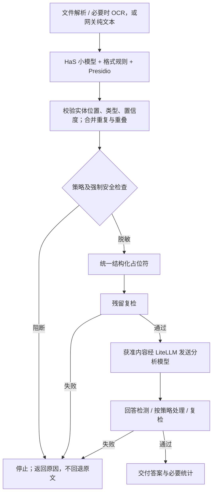

# 安全脱敏原理

核心分工：**识别器找出敏感实体，策略决定如何处理，管道确保所有必选检查通过后才允许发送与交付。**

图表示共同保护原则，不表示 MCP 与 Gateway 使用同一套授权或彼此串联。网关额外检查 Key、用户、Channel 和固定策略版本；MCP 使用文件访问范围、安全引用和受控任务入口。

## 怎么识别

默认语义识别为 RedactionEverything 调用 HaS 0.6B：根据上下文找姓名、机构、地址等；格式规则找手机号、邮箱、证件等候选；Presidio 补充识别。共享核心是 `PrivacyGuard.detect`，长文本按 2400 字符、300 字符重叠分块。额外 MLX NER 需要显式启用；默认分析用 Qwen3 不是替代 HaS 的扫描器。

“预设实体”指类型定义和匹配规则，不是所有真实人名的词典。位置、原值、类型和置信度需要校验；重复原值扩展后再合并。识别器均可能漏检或误报，复检并不能消除相关模型重复犯错的可能。

## 假名化、遮盖和加密的区别

| 方式 | 含义 | 本管道如何使用 |
|---|---|---|
| 遮盖 | 用色块或符号隐藏显示 | 仅盖色块不能证明 PDF 文本层等已清除 |
| 假名化 | 用 `<PERSON_001>` 等替代原值 | 保留文本关系，减少模型看到直接标识的机会 |
| 加密 | 使用密钥将内容变成密文 | 不是占位符替换的同义词；不能宣称当前所有本机数据都加密存储 |
| 不可逆匿名化 | 在适用背景下无法再识别个人 | 当前不承诺达到；上下文和准标识仍可能导致再识别 |

同一处理过程内，相同类型和原值保持相同占位符；不承诺跨请求稳定身份或同名属于同一人。Gateway 不持久保存可还原映射；MCP 默认入口也不提供自动回填。桌面映射导出不能当作 Gateway 已支持授权还原。

## 策略如何保护管道

Gateway 可编辑请求/回答的默认动作及类型覆盖，动作限 REDACT 或 BLOCK；ALLOW 仅在检查成功且没有需要处理的实体时出现，不能配置敏感原值直通。凭据标记、无效检测结果、未知占位符、残留及指定低置信度语义类型仍有强制检查。

草稿保存使旧测试失效；通过与当前内容绑定的测试才能发布不可变版本；发布不等于上线，需显式绑定 Channel。每次请求固定同一策略处理输入和回答。发送前、返回前复核授权与审计，撤销不能追回已经发出的数据。

MCP 的 `privacy_process_and_ask` 默认只返回受控答案与统计，不把完整安全正文交给宿主 Agent；只有需要下载时才构建独立副本。分步工具的安全引用是凭证，磁盘路径不是引用。复制引用或安全文件仍需遵守访问权限。

## 什么才算通过

文本检查通过只表示当前识别及策略未发现需阻断内容。安全文件还需结构检查、重提取、重扫、已识别原值残留校验；无法验证时停止。副本重建会丢失原版式，不应把它当作原件法律证据或无损转换。

完整代码依据与已知识别冲突见 [技术路线](gateway-recognition-architecture.md)；本机数据保存、攻击边界和缺口见 [数据流](data-flow-and-boundaries.md)；实际验证方法见 [验收指南](reproducible-acceptance.md)。
