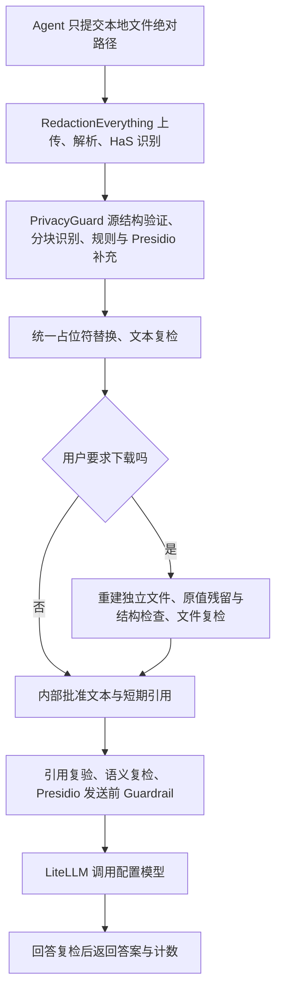

# 统一隐私处理流程与验收

日期：2026-10-15。代码目录：`PrivacyGuard`，GitHub：`bseazh/PrivacyGuard`。

本次已跑通可验证文本材料的默认分析和显式下载两条路径。没有制作 DMG、应用捆绑包或上传模型权重。

## 职责与实际调用顺序



任一步失败均返回 `blocked`，不回退原文，不使用宿主 Agent 模型继续分析。源结构检查只补充上游遗漏的可验证文本，不替代失败的上游解析。DOCX 页眉、页脚、脚注等补入检测；PDF 同样检查无文本页及未验证对象，避免只分析混合文件的一部分。

- RedactionEverything：统一通过 `/api/v1/files/upload`、`/parse`、`/ner` 解析与 HaS 识别；补充的长文档窗口也交给 HaS。空正文、识别失败、无效响应或实体偏移不匹配均阻断。
- PrivacyGuard：合并规则、HaS、Presidio 的结果，处理重复、重叠和分块，生成 `<PERSON_001>`、`<EMAIL_001>` 等占位符，同次处理同类型同值保持一致。文件处理期间再次计算源 SHA-256，变化即阻断。
- Presidio：补充检测、残留检测，且在 LiteLLM 发请求前运行必须通过的 Guardrail。记录上游测试验证了该调用顺序和失败不发送。
- LiteLLM：仅接收引用校验和各项复检通过的内容，任务仅允许 `summary` / `risk_summary`。不接收任意原始提示词、路径或模型地址。回答也需检测通过。

新流程不调用 RedactionEverything 的脱敏 execute/download。替换、重建和安全批准均由 PrivacyGuard 统一负责，避免两套假名化策略和重复导出。

## 分析与下载

默认聊天入口：

```text
privacy_process_and_ask(file_path="/绝对路径/合同.txt", task="risk_summary", create_safe_copy=false)
```

仅分析：不重建 PDF、DOCX 或 TXT 副本；安全文本与引用留在后台，聊天只返回 `status`、`answer`、`counts`、任务和 Guardrail 标识，`safe_file=null`。不返回安全正文或 bearer 引用。

明确要求下载时才设置 `create_safe_copy=true`。文件重新抽取文本，检查已识别原值、结构和敏感残留，全部通过才创建批准引用；分析也通过后，高层入口返回 `safe_file.path`。低置信度机构、地址、法院、律所、部门、项目等语义实体会阻断文件导出，不能关闭检查强行交付。

| 输入格式 | 普通分析 | 显式下载 |
| --- | --- | --- |
| TXT / MD / Markdown | 上游按文本解析，使用内部安全文本 | 独立 UTF-8 TXT |
| 纯文本 EML | 按文本处理，包含未编码头部 | 独立 UTF-8 TXT |
| 可验证的文本 PDF | 解析后检查完整源结构 | 独立纯文本重建 PDF |
| 可验证的 DOCX | 解析并补查页眉页脚等 | 独立纯文本重建 DOCX |
| 扫描页、图片、矢量或复杂 PDF | 当前阻断 | 阻断 |
| DOCX 图片、修订、域、嵌入对象、外链 | 阻断 | 阻断 |
| MIME 多部件、附件、编码 EML | 上传前阻断 | 阻断 |

PDF/DOCX 不保留排版、签章、图片、批注或附件；原文件不修改。导出文本格式现在真正生成文件，不再返回旧的 `safe-text-reference` 导出类型。

## 本机验收结果

环境：Apple Silicon、Python 3.11；真实 RedactionEverything `127.0.0.1:8000`、HaS 0.6B `:8080`、Presidio `:5002`、本地 MLX Qwen3 1.7B `:8011/v1`。

1. `./scripts/test_privacyguard.sh` 退出码 0：首组回归 49 项、LiteLLM 受控调用 10 项通过；真实 MCP stdio 发现六个工具，TXT/MD/Markdown/纯文本 EML 扫描，以及文本 PDF/DOCX 扫描和安全文件导出通过。
2. 随后增加混合 PDF 空白页阻断用例并完成定向回归：Core、安全文件、SecureAsk、上游适配、prompt variants、MLX parser 共 56 项通过（与上一组部分重叠，不能相加作为总数）。
3. `tests/secure_ask_live.py` 通过真实 MCP → HaS/规则/Presidio → LiteLLM → 本地 Qwen3：DOCX 安全文件引用分析、TXT 导出引用分析、默认统一分析、统一入口显式下载均通过。
4. 默认分析前后对后台目录作文件集合比较，没有新增 TXT/PDF/DOCX 副本，`safe_file=null`；统一入口未返回正文或引用。
5. 虚构样本检测 PERSON=1、EMAIL=1、PHONE=1，回答和重新提取的安全文件中均未残留样本人名、邮箱、手机号。重复人名的稳定占位符由回归测试覆盖。
6. 记录上游 + 真实 LiteLLM SDK 测试确认请求包含占位符、不含原始邮箱与手机；Presidio Guardrail 通过后上游才收到请求。离线、畸形响应、残留实体、无效引用、过期、文件篡改等均阻断。
7. 新增测试覆盖上游解析失败不回退、实体偏移错误、处理期间源文件改变、DOCX 上游遗漏页眉页脚、混合 PDF 空白页、输出验证失败不创建引用，以及编码邮件拒绝。

测试使用虚构材料和临时目录；临时安全副本测试后删除，没有使用客户合同。本次验收启动新 MCP stdio 进程验证当前代码，未声称现有 Codex 长驻进程已热更新；更新后须重启 Codex/WorkBuddy。WorkBuddy 实际聊天接入本次未验收。

## 必须保留的限制

- **OCR 尚未形成完整的安全分析入口。** 当前上游 parser 每页平均少于 100 字会判为扫描件，parse 返回空正文；vision 接口返回识别框，并非完整逐页 OCR 正文。因此短 PDF 也可能被误分类而阻断。本次真实测试发现并保留了这一阻断，没有用本地提取绕过。后续应由 RedactionEverything 返回全页 OCR 文本、页码覆盖和失败标记，再验证完整性后接入；不能拼接敏感区域框冒充全文。
- **模型答案质量未通过全面验收。** 本次真实风险回答仍把“付款期限未约定”扩大成“付款条件不明确”，并建议核查隐含或默认期限；这些不符合严格依据材料分析的要求。前一轮 `tests/answer_quality_live.py` 的已知质量失败仍有效。本次通过的是受控发送与隐私复检，不代表法律判断正确。不得自动用于法律决策。
- **检测不能证明零漏检。** HaS、规则、Presidio 均可能遗漏实体；不确定的已检出实体先替换，文件导出另有阻断阈值。人工确认工作流仍需完善。
- **不是零落盘。** 内部安全文本/引用保存到批准目录，上游可能持久保存原始上传和识别分块。默认引用有效期 900 秒，但过期不等于自动删除文件。请使用受控本地目录和保留策略。
- **不是宿主流量拦截器。** Skill 只能引导合作的 Agent；无法强制阻止 Codex/WorkBuddy 提前读文件，也不会接管它们内置模型的流量。
- 默认 HaS 做识别，MLX/Qwen3 做分析。额外 MLX NER 需显式设置 `PRIVACYGUARD_ENABLE_MLX_ENSEMBLE=1` 和 `PRIVACYGUARD_MLX_PYTHON`；仅配置 Python 路径不再启用第二套识别。启用但未配置路径、模型失败时阻断。

## 用户怎么测试

重启 Codex 后，使用虚构材料向 Agent 输入：

```text
请使用 $privacyguard 保护隐私后，分析 /绝对路径/虚构合同.txt 并总结风险，不需要下载副本。
```

要求下载时改为：

```text
请使用 $privacyguard 分析 /绝对路径/虚构合同.docx，并提供经过验证的脱敏副本。
```

Agent 默认仅调用 `privacy_process_and_ask`；按需设置 `create_safe_copy`。看到 `blocked` 应报告原因并停止，不读取原文、不调用 `privacy_get_safe_content` 自行分析、不转交宿主模型。

开发验收：在服务运行时执行 `./scripts/test_privacyguard.sh`。答案依据性需另外运行 `tests/answer_quality_live.py` 并如实报告失败，不能用隐私链路通过替代该项结果。历史格式报告与文件验收报告已加更新提示，以本文描述的当前行为为准。
