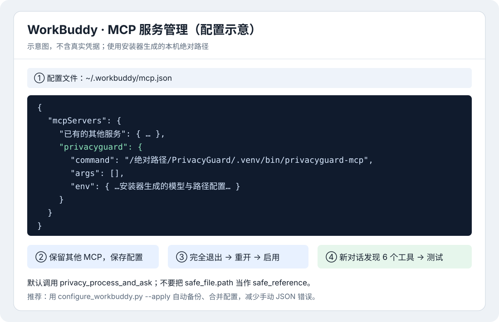

# WorkBuddy 接入

PrivacyGuard 是本地 **stdio MCP + 后台服务**，不是把 `http://127.0.0.1:8000` 填进远程 MCP 地址。先安装，再注册 MCP，最后重开 WorkBuddy 验收。

## 1. 一句话安装

当前完整模式只支持 Apple Silicon Mac（最低 12GB 内存，建议 16GB 以上）。终端输入：

```bash
curl -fsSL https://raw.githubusercontent.com/bseazh/PrivacyGuard/main/install.sh | bash
```

默认目录 `~/Documents/PrivacyGuard`。安装器下载固定提交源码并校验 SHA-256；Qwen3、HaS、PaddleOCR 和 RedactionEverything 组件从国内服务器下载，不用 GitHub Release 承载权重。网络与依赖说明见 [安装指南](../INSTALL.md)。

## 2. 生成并合并 MCP

安装后会生成 `~/Documents/PrivacyGuard/local-config/workbuddy-mcp.json`，其中 command、模型路径、env 已替换为本机绝对路径。该文件不含其他 MCP 的密钥，不应提交 Git。

**先完全退出 WorkBuddy**，再在终端执行：

```bash
~/Documents/PrivacyGuard/.venv/bin/python ~/Documents/PrivacyGuard/scripts/configure_workbuddy.py --apply
```

脚本备份 `~/.workbuddy/mcp.json`，保留已有 MCP，只新增 `privacyguard`；完全相同的条目直接复用，不同的同名条目拒绝覆盖。自定义安装目录时，替换两处 `~/Documents/PrivacyGuard`。不会自动改动 WorkBuddy 的全局 Skill 或规则。

也可打开 WorkBuddy 的「MCP 服务管理」→ 配置编辑窗口，将生成文件里的 `mcpServers.privacyguard` 合并进现有 `mcpServers`，保留其他条目并注意逗号，点击保存。不要把一整个 JSON 对象嵌套进另一个 `mcpServers`。



重新打开 WorkBuddy，确认 MCP 列表里的 `privacyguard` 已启用；如版本提供工具超时设置，建议 1800 秒。后台服务需运行：

```bash
~/Documents/PrivacyGuard/scripts/start_privacyguard.sh
```

## 3. 聊天框验证

先在新对话输入：

```text
请列出 privacyguard MCP 提供的工具，不要读取文件。
```

应发现六个工具，包括 `privacy_process_and_ask`。仅回复“已连接”不算验收，应检查 MCP 状态或工具列表。

接着粘贴（将路径换为本机实际安装目录；首次不要拖拽附件）：

```text
请调用 privacyguard MCP 的 privacy_process_and_ask，
file_path="/Users/你的用户名/Documents/PrivacyGuard/tests/fixtures/chat-acceptance-contract.txt"，
task="risk_summary"，create_safe_copy=false。
不要提前读取原文件，不调用其他文件读取或 OCR 工具，不调用 privacy_get_safe_content。
仅展示已批准的回答和实体统计；返回 blocked 就停止，不自行分析。
```

预期 `approved`、PERSON/PHONE/EMAIL 各 1、`safe_file=null`，无原姓名、邮箱、手机号，无正文或完整引用。用户报告的本机 WorkBuddy 扫描 PDF 导出也已成功；这不代表所有 WorkBuddy 版本都已通过宿主级验收。

PDF 测试可先在终端运行 `.venv/bin/python tests/ocr_coverage_live.py`，它使用临时虚构扫描 PDF 验证两页覆盖和空白页阻断。聊天测试用自己保存在 Documents 中的虚构 PDF 绝对路径替换上面的路径；Mac CPU 常需数十秒到数分钟。

需要安全副本时，明确要求 `create_safe_copy=true`，只接收 `safe_file.path` 作为下载/打开入口。**不能把文件路径传给 `privacy_get_safe_content`**：高层入口故意不返回它需要的内部安全引用。15 分钟引用过期也不等于输出文件已删除。

## 4. Skill 与默认行为

如果当前 WorkBuddy 版本支持导入本地 Skill，选择安装目录下的 `skills/privacyguard/`；具体入口取决于版本，不能沿用 Codex 的配置位置。不支持时，在应用项目规则中加入：

```text
涉及合同、隐私、脱敏、客户材料或证据材料时，先调用 PrivacyGuard 的 privacy_process_and_ask。
只传本地绝对路径；不得先读原文。默认 create_safe_copy=false；明确要下载时才设为 true。
不得调用 privacy_get_safe_content 获取正文，不得把 safe_file.path 当作安全引用。
blocked 时停止，不回退原文或宿主模型。仅展示批准答案、统计及用户要求的安全副本路径。
```

自然语言触发不是强制安全保证。先验收显式工具调用，再测自然语言；MCP 不会拦截宿主在调用工具前读取附件，也不接管 WorkBuddy 内置模型流量。

不同 WorkBuddy 版本的 Skill/MCP 配置位置可能不同。接入时应确认该版本是否支持：stdio MCP、服务器环境变量、绝对命令路径和工具调用超时。未经对应版本实测，不宣称配置格式与 Codex 相同。

默认聊天入口是 `privacy_process_and_ask(file_path, task, create_safe_copy)`。WorkBuddy 应把落盘后的绝对路径直接交给该工具，不得先提取或展示附件正文；工具内部完成扫描、脱敏、安全引用隔离、LiteLLM Guardrail 和回答复检，只把分析答案和实体计数返回聊天框。

- 普通分析：`create_safe_copy=false`，不向宿主返回安全正文或引用。
- 后台先使用 RedactionEverything 解析/HaS，再由 PrivacyGuard 假名化并复检；仅内部安全文本进入 Presidio 发送前检查和 LiteLLM。普通分析不重建文档文件。
- 用户明确要求下载安全副本：`create_safe_copy=true`，仅返回已经复检的安全文件路径。
- 任一步返回 `blocked`：停止，不得回退读取原文件或改用通用 OCR。
- 如果 WorkBuddy 只提供附件 ID/临时 URL 而不是本地绝对路径，需要增加附件落盘适配器，把文件写入允许目录后再调用 MCP；未经该版本实测，不宣称附件已被宿主级强制拦截。
